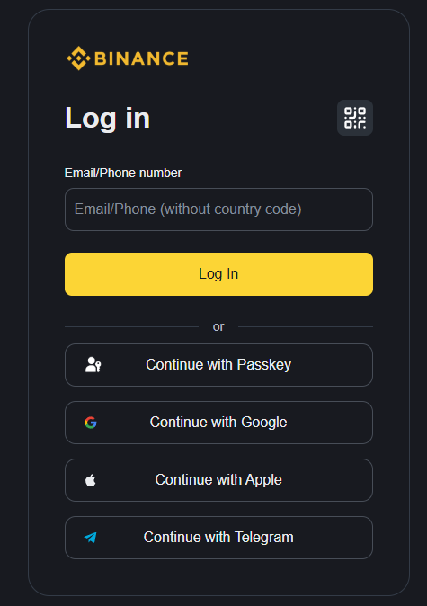

# Binance – Prijavni in registracijski obrazec

**Šolski projekt | Spletno programiranje | 2026/2027**

Šolski projekt, pri katerem sem izdelal prijavni in registracijski obrazec po vzoru spletne platforme **Binance**. Glavni cilj naloge je bil čim natančneje poustvariti videz izvirne spletne strani ter uporabiti pridobljeno znanje spletnega programiranja v praksi.

Projekt je izdelan z uporabo tehnologij **HTML5, CSS3 in JavaScript** ter je namenjen izključno izobraževalnim namenom.

---

## O projektu

Pri izdelavi sem se osredotočil na natančnost oblikovanja, preglednost uporabniškega vmesnika in pravilno strukturo spletne strani.

Glavni cilji projekta:

- Čim natančnejša poustvaritev izvirnega uporabniškega vmesnika Binance.
- Izdelava ločenega prijavnega in registracijskega obrazca.
- Uporaba sodobnih tehnik oblikovanja s CSS.
- Prilagoditev spletne strani različnim velikostim zaslonov.
- Implementacija osnovne interaktivnosti s pomočjo JavaScript.
- Pregledna organizacija in berljivost izvorne kode.
- Jasna označitev demonstracijskih funkcionalnosti.

## Uporabljene tehnologije

| Tehnologija | Namen |
|---|---|
| **HTML5** | Struktura spletne strani in obrazcev |
| **CSS3** | Oblikovanje, postavitev in odzivnost |
| **JavaScript** | Interaktivnost in demonstracijsko preverjanje podatkov |
| **Git & GitHub** | Verzijski nadzor in dokumentacija |
| **GitHub Pages** | Javna predstavitev spletne strani |

## Funkcionalnosti

Projekt vključuje naslednje funkcionalnosti:

- **Prijavni obrazec** – vnos testnega e-poštnega naslova in nadaljevanje prijavnega postopka.
- **Registracijski obrazec** – ločena stran za demonstracijo registracije.
- **Potrditvena koda** – uporaba vnaprej določene šestmestne kode.
- **Informativna pojavna okna** – prikaz testnih podatkov in opozoril, da gre za šolski projekt.
- **Odzivno oblikovanje** – prilagajanje postavitve različnim velikostim zaslonov.
- **Temna barvna shema** – vizualna podoba po vzoru platforme Binance.

---

## Testni podatki

Za preizkus obrazcev so pripravljeni demonstracijski podatki, ki omogočajo predstavitev prijavnega in registracijskega postopka.

### Prijava (Login)

| Podatek | Vrednost |
|---|---|
| E-poštni naslov | `test@gmail.com` |
| Šestmestna potrditvena koda | `123456` |

### Registracija (Register)

| Podatek | Vrednost |
|---|---|
| E-poštni naslov | `registertest@gmail.com` |
| Šestmestna potrditvena koda | `123456` |
| Geslo | `Binance67!` |
| Referalna koda (neobvezno) | `BINANCE2026` |

**Pomembno:** Vsi navedeni podatki so namenjeni izključno testiranju uporabniškega vmesnika.

---

## Predstavitev spletne strani

Spodaj so prikazani posnetki zaslona, ki predstavljajo oblikovanje spletne strani in njene demonstracijske funkcionalnosti.

### 1. Prijavni obrazec (Login)

Prijavna stran je oblikovana po vzoru izvirnega uporabniškega vmesnika Binance.

Vključuje vnosno polje za e-poštni naslov, gumb za prijavo ter vizualne elemente za alternativne načine prijave, kot so Google, Apple, Telegram in Passkey.

Glavni poudarek je na preglednosti, pravilni razporeditvi elementov in čim večji vizualni podobnosti z izvirno spletno stranjo.

### 2. Registracijski obrazec (Register)

Registracijska stran vsebuje dvodelno postavitev s promocijskim delom na levi in registracijskim obrazcem na desni.

Pri izdelavi sem posebno pozornost namenil usklajenosti barv, razmikom, tipografiji in pravilni razporeditvi elementov.

Stran vključuje vnos e-poštnega naslova, potrditveno polje za pogoje uporabe in vizualne možnosti alternativne registracije.

### 3. Informativno okno s testnimi podatki

Za lažje testiranje je dodano informativno pojavno okno, ki uporabniku prikaže potrebne demonstracijske podatke.

Okno vsebuje testni e-poštni naslov, šestmestno potrditveno kodo, geslo in neobvezno referalno kodo.

Hkrati opozarja, da gre za šolsko nalogo in da podatki niso namenjeni resnični registraciji.

---

## Pridobljeno znanje

Med izdelavo projekta sem utrdil znanje **HTML, CSS in JavaScript** ter pridobil dodatne praktične izkušnje pri oblikovanju sodobnih spletnih obrazcev.

Poseben poudarek je bil na:

- Uporabi CSS Flexbox za razporejanje elementov.
- Uporabi medijskih poizvedb (`@media`) za odzivno oblikovanje.
- Pravilni organizaciji HTML-strukture.
- Usklajevanju barv, velikosti in razmikov.
- Implementaciji interaktivnih elementov s pomočjo JavaScript.
- Izdelavi in oblikovanju pojavnih oken.
- Odpravljanju napak in preverjanju delovanja spletne strani.

## Avtor

**Avtor:** Tomaž Štefančič  
**Šolsko leto:** 2026/2027  
**Vrsta projekta:** Šolska naloga – spletni obrazec  

---

**Opozorilo:** Projekt je neuradna izobraževalna poustvaritev uporabniškega vmesnika Binance. Vse blagovne znamke, logotipi in pripadajoči grafični elementi so last njihovih zakonitih lastnikov. Spletna stran ni namenjena zbiranju resničnih prijavnih podatkov.
